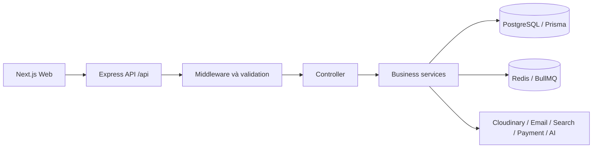
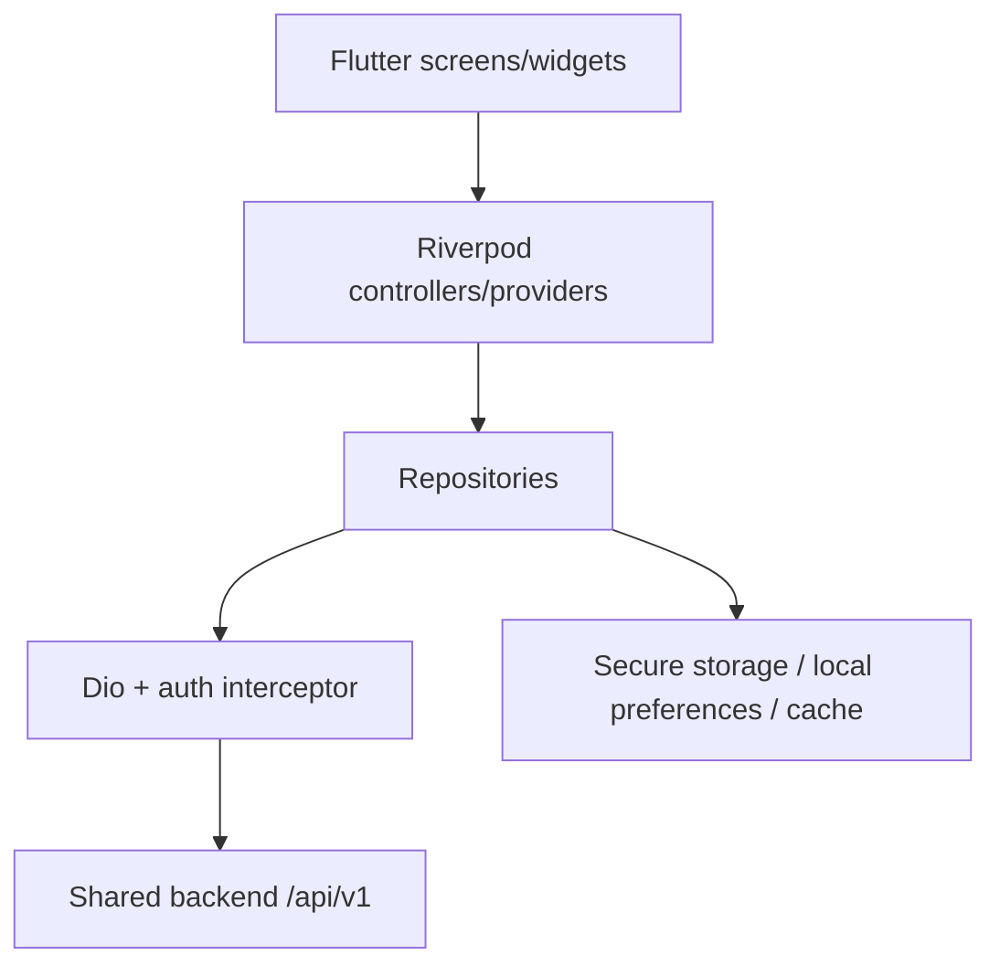
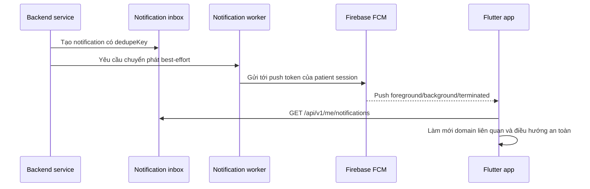
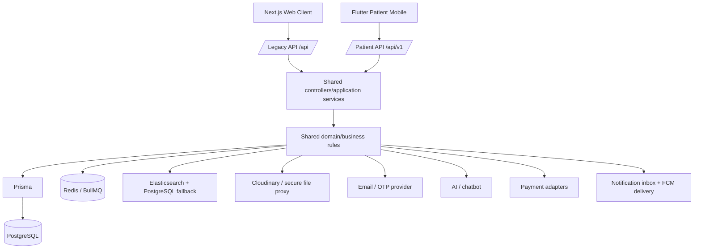

# BÁO CÁO QUÁ TRÌNH NÂNG CẤP BACKEND VÀ PHÁT TRIỂN ỨNG DỤNG MOBILE

**Hệ thống:** Web Hospital Booking
**Phạm vi báo cáo:** Từ hiện trạng backend phục vụ Web trước nâng cấp đến phiên bản Patient Mobile hiện tại
**Mốc đối chiếu ban đầu:** commit `39a62c0`
**Mốc đã merge vào `main`:** commit `31cb61d`
**Nhánh đang phát triển:** `feature/mobile-thong-bao`
**Ngày tổng hợp:** 14/10/2026

---

## 1. Mục đích báo cáo

Báo cáo này mô tả quá trình chuyển đổi hệ thống từ một backend chủ yếu phục vụ Web Next.js thành một backend dùng chung an toàn cho cả Web và ứng dụng Flutter dành cho bệnh nhân.

Trọng tâm của báo cáo không phải là liệt kê commit hoặc file đã sửa, mà trả lời bốn câu hỏi:

1. Trước khi nâng cấp, hệ thống có những chức năng gì và tồn tại hạn chế nào?
2. Những hạn chế đó ảnh hưởng thế nào khi mở rộng sang mobile?
3. Các giải pháp kỹ thuật và nghiệp vụ nào đã được triển khai?
4. Phiên bản hiện tại đã đạt được gì, còn thiếu gì trước khi có thể coi là hoàn thiện ở mức production?

Nguồn đối chiếu gồm source code hiện tại, lịch sử Git, Prisma schema, migration, tài liệu audit, test tự động và kết quả kiểm thử trên điện thoại Android thật.

---

## 2. Tóm tắt điều hành

Trước khi nâng cấp, hệ thống đã có nhiều domain nghiệp vụ quan trọng như bác sĩ, chuyên khoa, lịch làm việc, khung giờ, đặt lịch, hồ sơ khám, đơn thuốc, hóa đơn, thanh toán, nội dung công khai và chatbot. Tuy nhiên, các luồng được thiết kế chủ yếu quanh Web; bệnh nhân chưa có phiên đăng nhập độc lập phù hợp cho mobile, API chưa version, quyền sở hữu dữ liệu y tế chưa đồng nhất, một số chuyển trạng thái có nguy cơ cạnh tranh dữ liệu, thanh toán mock có thể bị sử dụng sai môi trường và chưa có hạ tầng thông báo cho thiết bị.

Quá trình nâng cấp giữ nguyên định hướng **một backend dùng chung**, không tạo backend riêng cho Flutter và không thay PostgreSQL/Prisma hay viết lại Web. Các thay đổi được thực hiện theo hướng cộng thêm và tương thích ngược:

- Phase 0 củng cố bảo mật, toàn vẹn dữ liệu, vòng đời OTP/lịch hẹn/thanh toán và bổ sung nền tảng kiểm thử.
- Phase 1 bổ sung API `/api/v1`, xác thực bệnh nhân bằng Bearer token, refresh-token rotation, quản lý nhiều phiên, API dữ liệu thuộc bệnh nhân và tải tài liệu y tế có kiểm tra quyền.
- Các giai đoạn mobile xây dựng Flutter foundation, luồng OTP, trang chủ, danh mục khám, đặt lịch, lịch khám, hồ sơ y tế, đơn thuốc, hóa đơn, hồ sơ cá nhân, chatbot và điều hướng dành riêng cho mobile.
- Giai đoạn hiện tại đã bổ sung hộp thư thông báo trong ứng dụng, đăng ký FCM token, worker chuyển phát push, điều hướng an toàn từ thông báo và cơ chế làm mới dữ liệu khi app resume, đổi tab hoặc nhận push.

Kết quả hiện tại là một Patient Mobile có thể sử dụng chung dữ liệu và nghiệp vụ với Web. Backend vẫn là nguồn sự thật duy nhất cho trạng thái lịch, quyền truy cập, chi phí và dữ liệu y tế. Mobile không truy cập trực tiếp PostgreSQL, Prisma, Redis, Firebase Admin hoặc secret của dịch vụ ngoài.

---

## 3. Kiến trúc và chức năng trước khi nâng cấp

### 3.1 Kiến trúc ban đầu

Hệ thống ban đầu là một modular monolith:



Backend đã có cấu trúc router → middleware → controller → service → Prisma/external service tương đối rõ. Đây là nền tảng tốt và được giữ lại thay vì chuyển sang microservice hoặc xây backend thứ hai cho mobile.

### 3.2 Chức năng đã có

Trước nâng cấp, Web đã có các nhóm chức năng chính:

- Nội dung công khai: banner, chuyên khoa, bác sĩ, gói khám, FAQ và cấu hình website.
- Đặt lịch khám và xác thực lịch bằng OTP.
- Quản lý lịch làm việc, khung giờ và trạng thái lịch hẹn trên dashboard.
- Tra cứu lịch, kết quả khám, hồ sơ y tế và đơn thuốc.
- Hóa đơn, giao dịch thanh toán và luồng thanh toán mock/phác thảo provider.
- Quản trị người dùng, bác sĩ, nhân viên và phân quyền dashboard.
- Chatbot hỗ trợ tra cứu, hướng dẫn và tìm kiếm thông tin.
- Redis/BullMQ, Elasticsearch có PostgreSQL fallback, Cloudinary và email.

### 3.3 Những hạn chế ảnh hưởng trực tiếp đến mobile

| Hiện trạng trước nâng cấp | Ảnh hưởng | Mức độ |
|---|---|---:|
| API tập trung dưới `/api`, chưa có contract versioned cho client mới | Web và mobile dễ phụ thuộc cùng một response có thể thay đổi | Cao |
| Bệnh nhân chưa có access/refresh session riêng | Không thể duy trì đăng nhập an toàn trên nhiều thiết bị | Nghiêm trọng |
| Một số API dữ liệu y tế dùng booking code/phone hoặc thiếu ownership boundary thống nhất | Có nguy cơ truy cập dữ liệu không thuộc bệnh nhân | Nghiêm trọng |
| Refresh token chủ yếu phục vụ dashboard, chưa có device/session contract | Mobile khó logout từng thiết bị và xử lý token bị dùng lại | Cao |
| Một số appointment transition kiểm tra rồi cập nhật ở các operation tách biệt | Có cửa sổ race condition và trạng thái không nhất quán | Nghiêm trọng |
| OTP consume chưa hoàn toàn nguyên tử; cấu hình secret có fallback không phù hợp production | Hai request có thể tranh chấp OTP; cấu hình yếu khó phát hiện sớm | Cao |
| Lịch `PENDING_OTP` hết hạn chưa được giải phóng tự động đầy đủ | Slot có thể bị giữ dù người dùng bỏ dở | Cao |
| Payment mutation/mock settlement chưa được chặn đầy đủ theo ownership và môi trường | Không phù hợp để mobile gọi trực tiếp | Nghiêm trọng |
| Chưa có test regression/CI bao phủ các luồng nhạy cảm | Refactor backend để hỗ trợ mobile dễ làm hỏng Web | Cao |
| Chưa có inbox thông báo, device token hoặc push delivery | Không thể thông báo thay đổi lịch chủ động cho app | Trung bình |
| Chưa có cơ chế làm mới dữ liệu theo lifecycle của app | Dữ liệu trên mobile có thể cũ sau khi dashboard cập nhật | Cao đối với UX |

### 3.4 Kết luận tại thời điểm ban đầu

Backend có thể tái sử dụng phần lớn domain và business service, nhưng chưa nên kết nối trực tiếp một mobile client production. Hướng phù hợp là giữ kiến trúc hiện tại, sửa các lỗi nền tảng trước, sau đó bổ sung một lớp API versioned dành cho bệnh nhân.

---

## 4. Phase 0 — Củng cố bảo mật và toàn vẹn dữ liệu

### 4.1 Mục tiêu

Phase 0 xử lý các rủi ro có thể làm lộ dữ liệu, sai trạng thái hoặc phá luồng Web khi backend được mở cho thêm một client. Đây là giai đoạn sửa nền móng, chưa tập trung vào giao diện mobile.

### 4.2 Giải pháp đã thực hiện

#### Nền tảng test và CI

- Tách việc khởi tạo Express app khỏi tiến trình listen để có thể test HTTP mà không cần chạy server riêng.
- Thêm smoke test, integration test và workflow CI.
- Tạo `TEST_DATABASE_URL` riêng và cơ chế từ chối chạy destructive integration test nếu tên database/schema không chứa `test`.
- Giữ `DATABASE_URL` cho Web/app khi phát triển và kiểm thử thao tác thật; chỉ dùng `TEST_DATABASE_URL` cho test tự động có reset/migrate dữ liệu.

#### Bảo vệ dữ liệu bệnh nhân

- Bổ sung lookup grant có thời hạn sau khi OTP được xác minh.
- Kiểm soát quyền truy cập đối với lịch hẹn, kết quả khám, đơn thuốc và tài liệu y tế.
- Không dùng booking code/phone như một credential lâu dài cho mobile.

#### Appointment state machine và concurrency

- Chuẩn hóa transition hợp lệ của lịch hẹn.
- Dùng conditional update/transaction để chỉ một request được phép chuyển trạng thái từ giá trị mong đợi.
- Đồng bộ appointment, slot và appointment log trong transaction phù hợp.
- Dùng mã lỗi ổn định như `APPOINTMENT_STATE_CONFLICT` và `APPOINTMENT_SLOT_CONFLICT` để client xử lý mà không phụ thuộc thông báo tiếng Việt.

#### OTP và lịch chờ xác thực

- Chuyển OTP consume sang cơ chế nguyên tử.
- Kiểm tra cấu hình secret theo hướng fail-fast.
- Tự động xử lý lịch `PENDING_OTP` hết hạn bằng BullMQ/worker và logic đối soát định kỳ.
- Chỉ cập nhật dữ liệu bệnh nhân chuẩn sau bước xác minh phù hợp, tránh để dữ liệu chưa xác thực ghi đè hồ sơ.

#### Payment safety

- Bổ sung ownership check, environment gate và idempotency.
- Không quảng bá thanh toán mock như một capability dành cho mobile.
- Các phần chưa có provider/webhook production hoàn chỉnh được giữ ngoài Patient Mobile MVP.

#### Error contract và audit

- Chuẩn hóa response lỗi có `code`, `message`, `requestId` và chi tiết validation khi phù hợp.
- Bổ sung request context và các điểm audit cần thiết cho việc điều tra lỗi.

### 4.3 Mục tiêu đã đạt

- Có hàng rào tự động trước các regression quan trọng.
- Giảm nguy cơ IDOR đối với dữ liệu y tế.
- Giảm race condition khi cập nhật lịch hẹn và sử dụng OTP.
- Slot bị giữ bởi lịch OTP hết hạn có cơ chế giải phóng tự động.
- Payment mock không còn được xem là luồng thanh toán production cho mobile.
- Web cũ tiếp tục hoạt động qua route legacy; thay đổi không buộc frontend phải rewrite ngay.

### 4.4 Thành phần chính

- `backend/src/app.ts`
- `backend/src/config/environment.ts`
- `backend/src/middlewares/lookupGrant.middleware.ts`
- `backend/src/services/appointment.service.ts`
- `backend/src/services/payment.service.ts`
- `backend/src/queues/appointmentLifecycle.queue.ts`
- `backend/src/workers/appointmentLifecycle.worker.ts`
- `backend/test/integration/baseline.test.ts`
- `.github/workflows/phase0.yml`

---

## 5. Phase 1 — Backend sẵn sàng cho Patient Mobile

### 5.1 Chiến lược tương thích

API mobile được bổ sung theo hướng additive:

```text
Web hiện tại     -> /api/...    -> giữ tương thích
Flutter Mobile  -> /api/v1/... -> contract mới dành cho patient
                         |
                         v
              dùng chung application/domain services
```

Không tạo database, business rule hoặc backend riêng cho Flutter.

### 5.2 Xác thực và quản lý phiên

Backend hiện hỗ trợ:

- Yêu cầu OTP đăng nhập bệnh nhân.
- Xác minh OTP để tạo patient session.
- Access token ngắn hạn dùng theo chuẩn Bearer.
- Refresh token dùng một lần và được xoay vòng.
- Reuse detection: nếu refresh token cũ bị dùng lại, token family liên quan bị thu hồi.
- Nhiều phiên cho nhiều thiết bị.
- Xem danh sách phiên, logout phiên hiện tại và thu hồi từng phiên.
- Metadata thiết bị như device id, platform và app version.

Model database cũ `DashboardSession` được mở rộng bằng `SessionKind` thay vì tạo một hệ session mới trùng lặp. Đây là lựa chọn tối ưu tái sử dụng hạ tầng đã có, dù tên model vẫn mang dấu vết lịch sử.

### 5.3 API `/api/v1`

Các nhóm endpoint chính:

| Nhóm | Khả năng hiện tại |
|---|---|
| Auth | Request OTP, verify OTP, refresh, logout |
| Session | Liệt kê và thu hồi phiên |
| Profile | Đọc/cập nhật hồ sơ bệnh nhân |
| Catalog | Banner, chuyên khoa, bác sĩ, gói khám, FAQ, site settings |
| Booking | Tạo lịch và xác minh OTP đặt lịch |
| Appointment | Danh sách, chi tiết, hủy lịch thuộc bệnh nhân |
| Medical record | Danh sách, chi tiết và tải file có kiểm tra quyền |
| Prescription | Danh sách và chi tiết đơn thuốc đã phát hành |
| Invoice | Danh sách và chi tiết hóa đơn |
| Chatbot | Dùng chung API chatbot hiện có qua alias v1 |
| Capabilities | Công bố tính năng backend đang cho phép client sử dụng |

Response thành công dùng `{ success, data, meta? }`; lỗi dùng `{ success: false, code, message, requestId, errors }`. List có pagination metadata và giới hạn kích thước trang.

### 5.4 Ownership và dữ liệu y tế

- `patientId` lấy từ access token, không nhận từ query/body.
- Resource không thuộc bệnh nhân trả `404` để không làm lộ sự tồn tại.
- Medical record chỉ hiển thị khi đã publish; prescription chỉ hiển thị khi đã issue.
- DTO không trả trực tiếp các trường nội bộ nhạy cảm của Prisma.
- File y tế được tải qua backend; backend kiểm tra ownership, HTTPS allowlist, timeout, redirect và kích thước.

### 5.5 Đồng bộ lịch bác sĩ và slot

- Weekly schedule được coi là template cho slot tương lai.
- Slot đã gắn với lịch đang hoạt động không bị tự động xóa hoặc di chuyển.
- Reconciliation tự sửa các sai lệch an toàn và chỉ báo cáo các trường hợp không thể suy luận đúng/sai.
- Worker có thể chạy đối soát định kỳ; dashboard có endpoint chạy thủ công.

### 5.6 Mục tiêu đã đạt

- Mobile có auth contract độc lập và an toàn hơn thay vì tái sử dụng cookie dashboard.
- Một bệnh nhân có thể dùng nhiều thiết bị và logout theo phiên.
- Mobile chỉ thấy dữ liệu thuộc bệnh nhân đang đăng nhập.
- API v1 có thể phát triển mà không phá Web legacy.
- Những business rule quan trọng vẫn nằm ở backend và được dùng chung giữa Web/mobile.

---

## 6. Từ Flutter Foundation đến Patient Mobile hiện tại

### 6.1 Nền tảng Flutter

Ứng dụng được tổ chức theo feature với ranh giới presentation, application, data và domain vừa đủ:



Các quyết định nền tảng:

- `Dio` làm HTTP client.
- `Riverpod` quản lý state và dependency.
- `go_router` quản lý route, guard và shell navigation.
- Refresh token lưu trong secure storage; cơ chế refresh được điều phối single-flight để tránh nhiều request refresh đồng thời.
- Có cấu hình `dev/prod` qua `--dart-define-from-file`.
- Lỗi mạng/API được chuyển thành thông báo có ngữ cảnh cho người dùng.
- Có cache nhẹ cho dữ liệu đọc; không queue offline các mutation nhạy cảm như booking/payment.

### 6.2 Luồng khởi động và xác thực

Phiên bản hiện tại có:

- Splash khôi phục phiên an toàn.
- Welcome screen cho người dùng mới lựa chọn đặt lịch hoặc đăng nhập.
- Đăng nhập bằng số điện thoại/email theo contract backend và xác minh OTP.
- Điều hướng thẳng từ màn gửi OTP sang màn xác thực, không đi vòng qua Trang chủ.
- Lỗi của một lần gửi OTP không bám sang màn hình khác hoặc phiên thao tác sau.
- Khi token hết hạn, client refresh phiên; nếu phiên không còn hợp lệ, state auth được làm sạch và route guard đưa về luồng phù hợp.
- Logout có xác nhận, làm sạch token/state và quay về màn phù hợp thay vì để lại dữ liệu của phiên cũ.

### 6.3 Trang chủ và khám theo danh mục

Trang chủ hiện đồng bộ dữ liệu với Web cho:

- Hero banner có tự động chuyển slide và điều khiển thủ công.
- Chuyên khoa, bác sĩ, gói khám và FAQ.
- Shortcut tới các chức năng chính.
- Chatbot/trợ lý đặt lịch.
- Trạng thái đăng nhập và nội dung cá nhân hóa.

Các màn chuyên khoa, chi tiết bác sĩ và chi tiết gói khám lấy dữ liệu từ backend. Điều hướng được xây theo stack nên thao tác Back quay về màn trước, không thoát app ngoài ý muốn.

### 6.4 Luồng đặt lịch

Mobile đã hỗ trợ luồng:

```text
Chọn chuyên khoa/bác sĩ/gói khám
        -> chọn ngày và slot
        -> nhập/xác nhận thông tin bệnh nhân
        -> tạo lịch PENDING_OTP
        -> xác minh OTP
        -> lịch chuyển PENDING_CONFIRM
        -> xem kết quả đặt lịch
```

Điểm đáng chú ý:

- Có thể đi vào booking từ bác sĩ, chuyên khoa hoặc gói khám.
- Gói khám được truyền xuyên suốt flow và đồng bộ vào appointment.
- Dữ liệu giá/BHYT hiển thị theo kết quả backend; mobile không tự quyết định business rule.
- Pending booking được lưu cục bộ vừa đủ để khôi phục màn OTP nhưng không trở thành nguồn dữ liệu chuẩn.
- Sau khi đặt lịch thành công, các provider liên quan được làm mới.

### 6.5 Lịch khám của tôi

- Danh sách lịch của bệnh nhân theo session.
- Hiển thị trạng thái nghiệp vụ, mã lịch, thời gian, bác sĩ, chuyên khoa, gói khám và chi phí.
- Chi tiết lịch tải lại theo id thuộc bệnh nhân.
- Hủy lịch theo rule backend.
- Pull-to-refresh và nút làm mới.
- Làm mới có kiểm soát khi người dùng quay lại tab hoặc app resume.
- Điều hướng từ thông báo tới đúng lịch hẹn.

### 6.6 Hồ sơ khám, đơn thuốc và hóa đơn

Ứng dụng hiện có:

- Danh sách và chi tiết hồ sơ khám đã publish.
- Xem/tải tài liệu và lab result qua API có Bearer auth.
- Danh sách và chi tiết đơn thuốc đã issue.
- Danh sách và chi tiết hóa đơn, bao gồm phần chi phí và BHYT.

Thanh toán online chưa được bật cho Patient Mobile. Backend công bố `payment.enabled=false`; đây là quyết định chủ động để tránh đưa luồng mock hoặc provider chưa có webhook/reconciliation hoàn chỉnh vào app.

### 6.7 Hồ sơ cá nhân

- Xem và cập nhật thông tin bệnh nhân.
- Hiển thị các nhóm dữ liệu cá nhân/y tế phù hợp.
- Đăng xuất có bước xác nhận và xử lý state nhất quán.
- Sau thay đổi hồ sơ hoặc auth, dữ liệu phụ thuộc được invalidate/làm mới.

### 6.8 Chatbot

Chatbot trên mobile tái sử dụng API và business action của backend/Web:

- Gửi và hiển thị hội thoại.
- Giữ session hội thoại.
- Hỗ trợ FAQ, hướng dẫn, tìm bác sĩ/chuyên khoa và điều hướng sang chức năng liên quan.
- Payload từ backend được chuẩn hóa trước khi dựng UI, tránh duplicate logic nghiệp vụ trong Flutter.

Chatbot không giữ secret AI trên mobile và không truy cập database trực tiếp.

### 6.9 UI/UX và điều hướng mobile

Phiên bản hiện tại đã chuyển từ giao diện chức năng tối thiểu sang trải nghiệm dành riêng cho điện thoại:

- Màu chủ đạo y tế xanh ngọc, nền sáng, card bo góc và phân cấp nội dung rõ.
- Bottom navigation nổi gồm Trang chủ, Lịch khám, Đặt khám, Trợ lý và Tài khoản.
- Shell navigation giữ state từng tab.
- Các màn chi tiết nằm ngoài shell nhưng giữ stack để Back quay lại đúng màn nguồn.
- Có empty state, loading, error banner, retry và thông báo khi mất kết nối.
- Các hành động nhạy cảm như logout/hủy lịch có xác nhận.
- UI đã được thử trên điện thoại Android thật, gồm màn hình dài, cuộn, Back và kết nối backend qua USB.

---

## 7. Hệ thống thông báo ở phiên bản hiện tại

### 7.1 Kiến trúc

Hộp thư trong ứng dụng là nguồn dữ liệu chính; Firebase Cloud Messaging chỉ là kênh chuyển phát:



Các model `Notification` và `NotificationDelivery` tách nội dung khỏi từng lần chuyển phát. Push token được gắn với patient session đã có, nhờ đó chưa cần tạo thêm một model Device trùng lặp.

### 7.2 Chức năng đã có

- Đăng ký/hủy push token theo phiên đăng nhập.
- Xin quyền thông báo và phản ánh trạng thái quyền trên UI.
- Inbox phân trang, số chưa đọc, đánh dấu một thông báo hoặc tất cả đã đọc.
- Dedupe thông báo theo sự kiện nghiệp vụ.
- Worker gửi lại có kiểm soát và ghi trạng thái delivery.
- Vô hiệu token không hợp lệ.
- Deep link theo allowlist entity; không mở URL tùy ý từ payload.
- Nhận push khi app foreground/background và xử lý notification-open.
- Làm mới danh sách liên quan sau push.
- Hiển thị riêng nội dung thông báo tại thời điểm gửi và trạng thái mới nhất của entity.

Ví dụ đã kiểm thử trên máy thật: thông báo lịch sử ghi “Hủy lịch khám”, trong khi appointment hiện tại đã là “Đang khám”. Màn chi tiết hiển thị một banner lịch sử riêng và vẫn lấy trạng thái hiện tại từ backend, tránh làm người dùng hiểu nhầm notification cũ là trạng thái mới nhất.

### 7.3 Sự kiện đã hỗ trợ

- Lịch khám được xác nhận.
- Lịch khám được đổi.
- Lịch khám bị hủy.
- Nhắc lịch khám.
- Bệnh nhân không đến (`NO_SHOW`).
- Kết quả khám được publish.
- Đơn thuốc được phát hành.
- Hóa đơn được tạo.
- Thanh toán thành công.
- Hoàn tiền.

### 7.4 Phần thông báo chưa hoàn thiện tuyệt đối

- Đã có notification type riêng cho `CHECKED_IN`, `IN_PROGRESS` và `COMPLETED`,
  kèm inbox, push delivery, deep link và đồng bộ dữ liệu mobile.
- Push production phụ thuộc Firebase Admin credential và tiến trình notification worker được cấu hình/chạy đúng môi trường.
- Android đã được kiểm thử thực tế; iOS push chưa được xác nhận end-to-end trên thiết bị thật.
- Chưa có trang quản trị template/campaign thông báo; hiện thông báo xuất phát từ event nghiệp vụ.

---

## 8. Cơ chế đồng bộ và làm mới dữ liệu

### 8.1 Vấn đề trước tối ưu

Khi dashboard cập nhật trạng thái lịch, app đang mở ở màn “Lịch khám của tôi” có thể tiếp tục hiển thị state cũ cho đến khi người dùng chủ động refresh hoặc mở lại màn. Đây là stale-client problem, không phải lỗi database.

### 8.2 Giải pháp hiện tại

`PatientDataSyncCoordinator` điều phối việc làm mới thay vì để từng màn gọi API tùy ý:

- App resume: refresh dữ liệu đã quá ngưỡng freshness.
- Đổi sang tab lịch khám: kiểm tra và refresh nếu stale.
- Nhận push: invalidate chi tiết entity và refresh list liên quan.
- Sau mutation như đặt/hủy lịch: refresh dữ liệu chịu ảnh hưởng.
- Có pull-to-refresh/nút refresh làm phương án chủ động.
- Dùng freshness window để tránh gọi lại toàn bộ API mỗi lần rebuild hoặc đổi tab nhanh.

### 8.3 Mục tiêu đã đạt

- Dữ liệu phản ánh dashboard nhanh hơn mà không cần WebSocket ngay lập tức.
- Giảm request dư so với polling dày ở mọi màn.
- Logic refresh tập trung, dễ mở rộng và test.
- Vẫn giữ backend làm nguồn sự thật; cache mobile chỉ phục vụ UX.

Đây là phương án cân bằng phù hợp ở quy mô hiện tại. Realtime socket chỉ nên bổ sung sau khi có nhu cầu SLA rõ ràng và số liệu tải thực tế.

---

## 9. Tối ưu dữ liệu demo và BHYT

Seed demo hiện được điều chỉnh để:

- Chỉ áp dụng BHYT khi bệnh nhân có BHYT và gói khám hỗ trợ BHYT.
- Tính eligible amount, tỷ lệ hưởng, mức giảm và tổng tiền từ cùng một hàm.
- Appointment và invoice dùng cùng kết quả tính toán, tránh mỗi nơi sinh một số khác nhau.
- Rerun seed cập nhật đầy đủ snapshot bệnh nhân/BHYT thay vì giữ field cũ.
- Luồng tạo hồ sơ khám demo chỉ chọn appointment có booking code bắt đầu bằng `BKDEMO`, tránh vô tình thay đổi lịch thật hoặc lịch test thủ công.

Code seed đã được tối ưu nhưng không tự động reset/seed database. Việc chạy `npm run seed:demo-full` vẫn là thao tác chủ động của người phát triển.

---

## 10. Kiến trúc hệ thống hiện tại



Nguyên tắc hiện tại:

- Web và mobile dùng chung domain/application service.
- PostgreSQL/Prisma là nguồn dữ liệu chuẩn.
- Mobile không truy cập trực tiếp database hoặc secret tích hợp.
- API legacy được giữ cho Web; API v1 tạo contract ổn định cho mobile.
- Những thay đổi schema được thực hiện bằng migration cộng thêm.

---

## 11. Bảng so sánh trước và sau

| Khu vực | Trước nâng cấp | Hiện tại | Giá trị đạt được |
|---|---|---|---|
| Kiến trúc | Backend chủ yếu phục vụ Web | Shared backend cho Web + Flutter | Không duplicate business logic |
| API | Legacy `/api`, contract chưa version | Additive `/api/v1` cho patient | Mobile và Web có thể phát triển độc lập hơn |
| Patient auth | OTP/lookup theo từng use case, chưa có patient session đầy đủ | Access token, refresh rotation, multi-session, revoke | Đăng nhập lâu dài và an toàn hơn trên thiết bị |
| Ownership | Không đồng nhất ở dữ liệu y tế/payment | Patient id từ token, 404 khi không sở hữu | Giảm nguy cơ IDOR/lộ dữ liệu |
| Appointment | Có state enum nhưng một số transition có race | Conditional transition + transaction + conflict code | Toàn vẹn trạng thái tốt hơn |
| OTP booking | Có thể giữ slot khi bỏ dở | Atomic consume + expiry worker/reconciliation | Giảm slot rác và tranh chấp |
| Payment | Mock/provider chưa hoàn chỉnh có thể bị hiểu là sẵn sàng | Gate theo môi trường; mobile capability tắt | Không đưa luồng không an toàn vào MVP |
| Dữ liệu y tế | URL/file access chưa có mobile ownership contract | Patient-scoped API + secure proxy | Tái sử dụng an toàn cho app |
| Testing | Ít regression gate | Smoke, integration, CI và Flutter tests | Giảm nguy cơ phá Web/mobile |
| Mobile | Chưa tồn tại | Patient app với các luồng chính | Có client mobile dùng chung hệ thống |
| Điều hướng | Chỉ Web | Router guard + shell + bottom nav + deep link | Trải nghiệm phù hợp điện thoại |
| Đồng bộ | Không có lifecycle mobile | Resume/tab/push/mutation refresh | Giảm dữ liệu cũ trên app |
| Thông báo | Chưa có patient inbox/push | Inbox + FCM + delivery worker | Cập nhật chủ động và có lịch sử |
| Chatbot | Chỉ Web | Tái sử dụng trên mobile | Không xây chatbot riêng |

---

## 12. Kiểm thử và bằng chứng chất lượng hiện tại

### 12.1 Backend

- TypeScript type-check đạt.
- Smoke test gần nhất: 10/10 test đạt.
- Integration suite bao phủ các contract quan trọng như backward compatibility, ownership, refresh-token reuse, multi-session, appointment concurrency, schedule reconciliation và notification lifecycle.
- Test tích hợp destructive được chặn nếu URL không chỉ rõ database/schema test.

### 12.2 Flutter

- `flutter analyze`: không có lỗi.
- Bộ test Flutter gần nhất: 116/116 test đạt.
- Test bao phủ config, API contract, refresh coordinator, auth/router guard, onboarding, booking, appointment, profile/logout, home, clinical data, invoice, notification và push controller.

### 12.3 Điện thoại Android thật

Đã xác minh:

- Cài và chạy app trên thiết bị Android 15.
- Refresh session thành công.
- Các API trang chủ, bác sĩ, chuyên khoa, gói khám, FAQ, thông báo và đăng ký push token trả HTTP 200.
- Luồng thông báo → chi tiết lịch → Back quay lại đúng danh sách.
- Notification lịch sử và trạng thái lịch hiện tại được phân biệt.
- Không có `FATAL EXCEPTION` hoặc crash trong log của luồng kiểm thử gần nhất.

---

## 13. Trạng thái chức năng hiện tại

| Chức năng | Trạng thái | Ghi chú |
|---|---|---|
| Backend dùng chung Web/mobile | Hoàn thành | Không có backend riêng cho Flutter |
| Phase 0 security/data integrity | Hoàn thành ở phạm vi đã duyệt | Có test/CI và compatibility |
| Patient auth/session API | Hoàn thành | Bearer + rotating refresh token |
| Flutter foundation | Hoàn thành | Networking, storage, router, state, error |
| Onboarding và OTP login | Hoàn thành | Đã kiểm thử thiết bị thật |
| Trang chủ/catalog/hero | Hoàn thành cơ bản | Dữ liệu đồng bộ Web; hero slide hoạt động |
| Đặt lịch + OTP | Hoàn thành cơ bản | Có bác sĩ/chuyên khoa/gói khám |
| Lịch khám | Hoàn thành cơ bản | List/detail/cancel/refresh |
| Hồ sơ khám | Hoàn thành cơ bản | Chỉ dữ liệu đã publish |
| Đơn thuốc | Hoàn thành cơ bản | Chỉ dữ liệu đã issue |
| Hóa đơn | Hoàn thành phần đọc | Chưa bật payment online mobile |
| Hồ sơ cá nhân/logout | Hoàn thành cơ bản | Có update và cleanup state |
| Chatbot | Hoàn thành đồng bộ cơ bản | Tái sử dụng backend hiện tại |
| In-app notification inbox | Hoàn thành cơ bản | Có unread/read/deep link |
| Android FCM push | Hoàn thành ở môi trường dev | Cần vận hành worker/credential production |
| Background data refresh | Hoàn thành cơ bản | Event/lifecycle based, không phải realtime socket |
| iOS push end-to-end | Chưa xác minh | Cần cấu hình và test thiết bị iOS |
| Thanh toán production | Chưa hoàn thành | Chủ động loại khỏi Patient MVP |

---

## 14. Những phần còn mở và hướng tiếp theo

### Ưu tiên 1 — Hoàn tất notification lifecycle (đã hoàn thành cho Android/backend)

- Đã gửi inbox/push cho `CHECKED_IN`, `IN_PROGRESS`, `COMPLETED`.
- Reminder dùng múi giờ nghiệp vụ Việt Nam và delivery còn pending được worker
  tiếp tục xử lý sau khi khởi động lại.
- Retry, invalid token, nhiều thiết bị và thiết bị đăng ký muộn đã có contract
  test; worker ghi số `FAILED/EXHAUSTED` trong log vận hành.
- iOS push vẫn cần xác minh riêng nếu được đưa vào phạm vi phát hành.

### Ưu tiên 2 — Kiểm thử end-to-end ổn định (đã có baseline tự động)

- Integration suite chạy bằng `TEST_DATABASE_URL`; không dùng database demo.
- Đã có `npm run test:e2e` cho chuỗi đặt lịch → xác nhận → đổi lịch →
  check-in → khám → hồ sơ → đơn thuốc → hóa đơn → notification → mobile đọc lại.
- Giữ kiểm thử thao tác Web/mobile trên `DATABASE_URL` demo và không chạy destructive integration test vào database này.

### Ưu tiên 3 — Production readiness

**Trạng thái: tạm hoãn kiểm thử thiết bị thật, chưa hoàn thành.** Checklist được
lưu tại `docs/checklist-kiem-thu-production-thiet-bi-that.md`.

- Xác minh Firebase service account, worker, Redis và env trên môi trường deploy.
- Bổ sung crash reporting/observability có chính sách không ghi lộ dữ liệu y tế.
- Kiểm thử release/profile build, mạng chậm, mất mạng và token hết hạn dài ngày.
- Kiểm thử iOS thật nếu iOS nằm trong phạm vi phát hành.

### Ưu tiên 4 — Payment nếu được đưa vào phạm vi

Chỉ mở payment trên mobile khi có provider thật, verified webhook, kiểm tra chữ ký/số tiền, idempotency, timeout, reconciliation và chính sách refund rõ ràng. Cho đến lúc đó, việc để `payment.enabled=false` là trạng thái đúng.

### Ưu tiên 5 — Tối ưu theo đo lường

- Đã bổ sung hạ tầng đo p50/p95, query count và log request chậm không lộ query/PII;
  hướng dẫn tại `docs/moc-do-hieu-nang-api.md`.
- Baseline trên dữ liệu demo cần chạy khi backend local đang hoạt động; chưa thêm
  cache/index nếu chưa có số liệu.

**Cập nhật 16/10/2026:** baseline public/patient API đã hoàn thành. Read path
lịch hẹn đã được tối ưu theo số liệu: list giảm từ 8 xuống 3 query và p95 từ
576.1 ms xuống 142.7 ms; detail giảm từ 7 xuống 2 query và p95 từ 287.4 ms
xuống 144.3 ms. Không bổ sung cache mới vì các endpoint còn lại đang dưới
ngưỡng cần can thiệp. Chi tiết tại `docs/moc-do-hieu-nang-api.md`.
- Chỉ bổ sung cache, index hoặc realtime channel khi có số liệu chứng minh bottleneck.
- Không tách microservice hoặc thêm WebSocket chỉ để “hiện đại hóa” kiến trúc.

---

## 15. Kết luận

Mục tiêu lớn nhất đã đạt được là chuyển hệ thống từ trạng thái **backend phục vụ Web** sang **shared application backend phục vụ đồng thời Web và Patient Mobile**, trong khi vẫn giữ lại phần lớn domain và business logic đang hoạt động.

Backend sau nâng cấp đã có ranh giới xác thực bệnh nhân, API versioned, ownership, session rotation, state transition an toàn hơn, worker lifecycle và test regression. Trên nền đó, Flutter mobile đã hình thành đầy đủ các luồng bệnh nhân chính: khởi động, đăng nhập OTP, khám theo danh mục, đặt lịch, quản lý lịch, xem hồ sơ/đơn thuốc/hóa đơn, quản lý cá nhân, chatbot, inbox và push notification.

Phiên bản hiện tại phù hợp để tiếp tục kiểm thử nghiệp vụ và hoàn thiện Patient Mobile MVP. Tuy nhiên, chưa nên gọi là production-complete cho đến khi hoàn tất vận hành push production, quyết định các trạng thái thông báo còn thiếu, kiểm thử E2E toàn chuỗi, quan sát hiệu năng và—nếu nằm trong phạm vi—hoàn thiện payment provider thực.

Điểm quan trọng cần tiếp tục duy trì là: **backend là nguồn sự thật duy nhất; Web và mobile chỉ là hai client của cùng domain; mọi mở rộng tiếp theo ưu tiên tái sử dụng, thay đổi cộng thêm và kiểm thử tương thích trước khi bổ sung kiến trúc mới.**

---

## Phụ lục A — Các tài liệu và module tham chiếu

- `docs/architecture-system-audit.md`
- `docs/phase-0-remediation-plan.md`
- `docs/phase-2-flutter-foundation.md`
- `backend/PHASE_1_MOBILE_READINESS.md`
- `backend/prisma/schema.prisma`
- `backend/src/services/appointment.service.ts`
- `backend/src/services/authSession.service.ts`
- `backend/src/services/patientPortal.service.ts`
- `backend/src/services/notification.service.ts`
- `backend/src/services/notificationDelivery.service.ts`
- `backend/src/services/patientEventNotification.service.ts`
- `backend/src/workers/appointmentLifecycle.worker.ts`
- `backend/src/workers/notification.worker.ts`
- `mobile/lib/app/router/app_router.dart`
- `mobile/lib/app/navigation/main_navigation_shell.dart`
- `mobile/lib/core/network/session_refresh_coordinator.dart`
- `mobile/lib/core/sync/patient_data_sync_coordinator.dart`
- `mobile/lib/features/notifications/`

## Phụ lục B — Quy ước môi trường dữ liệu

| Biến | Mục đích | Quy tắc |
|---|---|---|
| `DATABASE_URL` | Backend local/dev, Web và app thao tác dữ liệu demo | Không tự động reset bằng integration suite |
| `TEST_DATABASE_URL` | Test tích hợp có migrate/reset dữ liệu | Database hoặc schema bắt buộc chứa `test` |
| `GOOGLE_APPLICATION_CREDENTIALS` | Firebase Admin credential trên local | Trỏ tới file service account nằm ngoài Git |
| `FIREBASE_SERVICE_ACCOUNT_BASE64` | Firebase Admin credential trên production | Secret base64 do nền tảng deploy quản lý |
