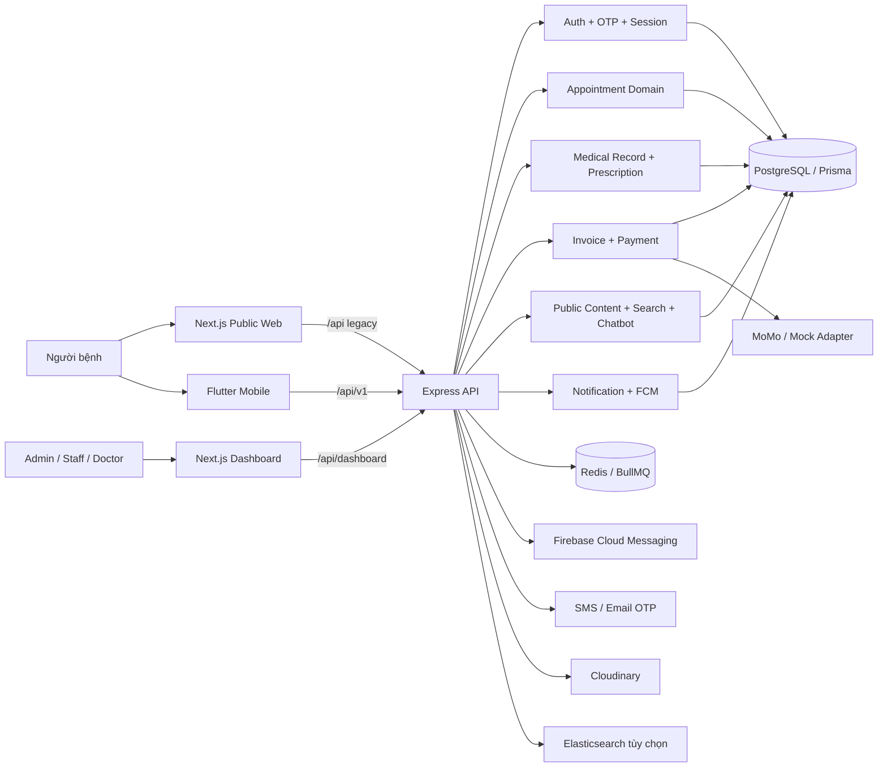
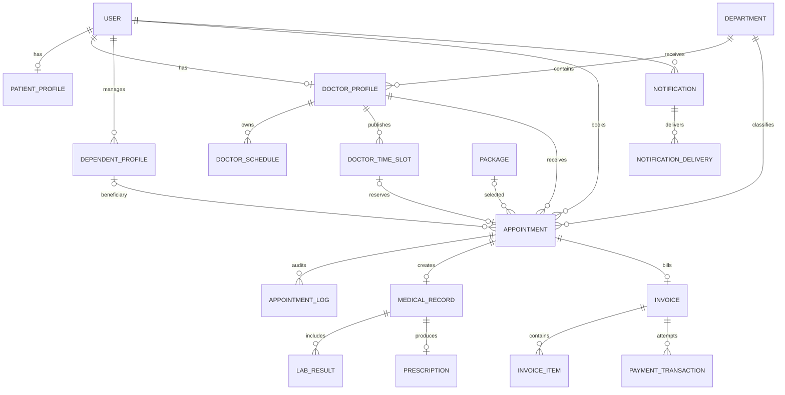
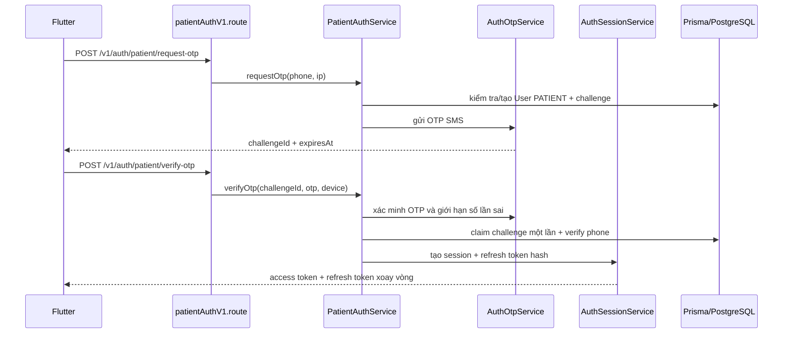
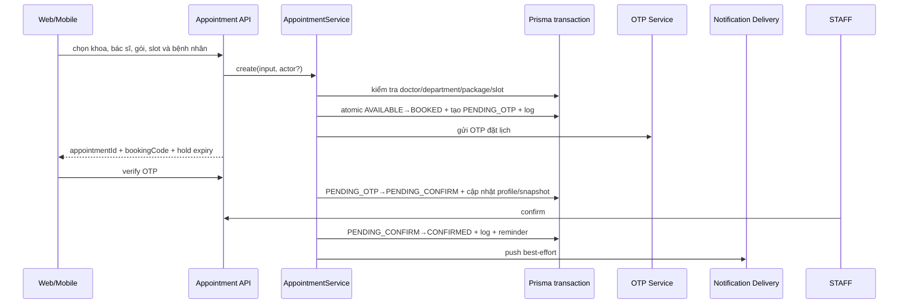
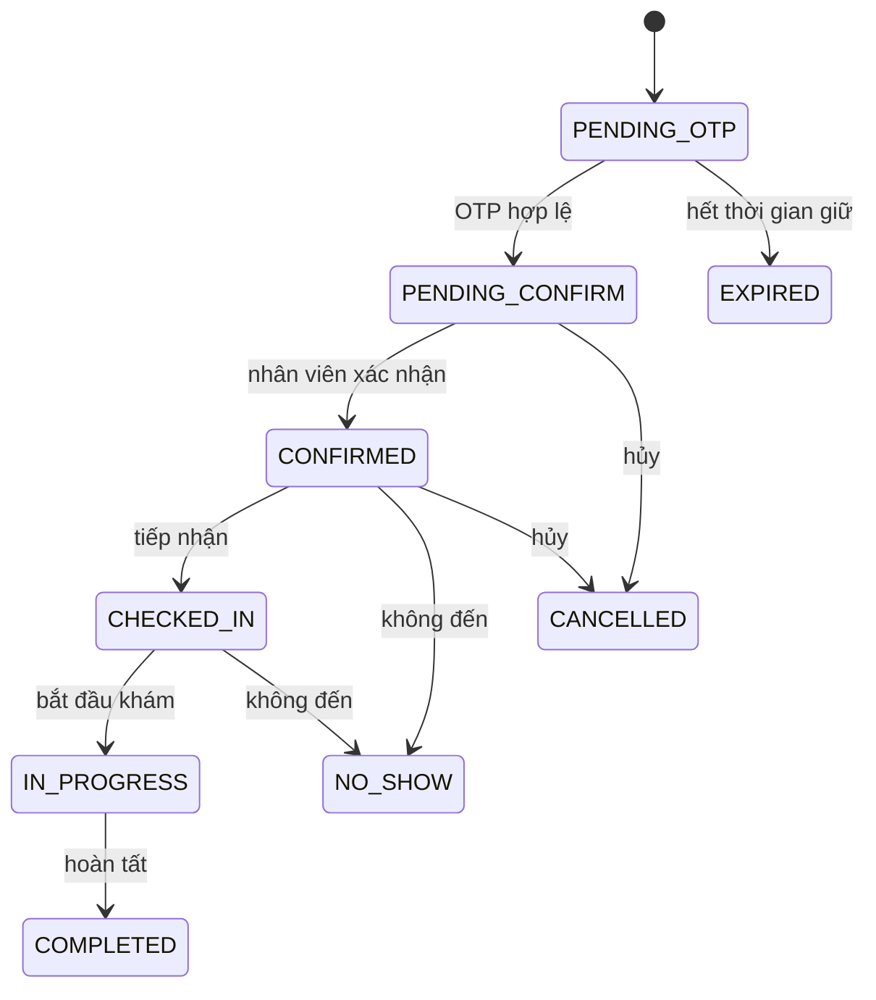

# Báo cáo phân tích source code Hospital Booking

> Ngày phân tích: 28/10/2026
> Phạm vi: `backend`, `frontend`, `mobile`, Prisma schema và các quan hệ API được suy ra từ code thực tế.
> Mục tiêu: phân tích kiến trúc và nghiệp vụ; không thay đổi source code.

## 1. Kết luận chính

Hệ thống đã phát triển thành kiến trúc đa kênh tương đối đầy đủ: một backend Express/Prisma phục vụ website công khai, dashboard quản trị Next.js và ứng dụng Flutter. Backend giữ vai trò nguồn sự thật duy nhất cho lịch hẹn, hồ sơ bệnh nhân, lịch bác sĩ, thông báo, hồ sơ khám, đơn thuốc, hóa đơn và giao dịch thanh toán.

Điểm mạnh nổi bật là các luồng quan trọng đã có kiểm soát cạnh tranh và truy vết: giữ slot bằng transaction, xác thực OTP, state transition có điều kiện, nhật ký lịch hẹn, refresh-token rotation, phân quyền dashboard, notification inbox và push delivery. Web và mobile cùng dùng hợp đồng API, nhưng có hai namespace song song: legacy `/api/*` cho web và versioned `/api/v1/*` cho mobile.

Rủi ro kiến trúc lớn nhất hiện tại không phải dependency cycle. Không phát hiện chu trình import nội bộ trong 379 file có quan hệ import được Graphify nhận diện. Rủi ro chính là:

1. `AppointmentService` dài 2.834 dòng, có 49 quan hệ và đang ôm tạo lịch, OTP, trạng thái, đổi/hủy lịch, notification, slot, tra cứu và audit.
2. Một số UI/component trở thành “god file”: `mobile/home_screen.dart` 1.933 dòng, `public-booking-widget.tsx` 1.321 dòng, `public-home-view.tsx` 1.139 dòng, dashboard appointments 929 dòng.
3. Helper HTTP/controller bị sao chép rộng: `getParam` xuất hiện ở 19 controller, `parseNumberQuery` ở 14, `parseBooleanQuery` ở 11, `getActor` ở 10; `normalizeOptionalString` lặp ở 9 service.
4. Backend service phụ thuộc trực tiếp nhiều vào Prisma singleton. Điều này đơn giản cho hiện tại nhưng làm tăng coupling, khó unit test theo miền và khó thay đổi persistence.
5. Hợp đồng dữ liệu được khai báo lại ở backend, web và mobile. Chưa thấy một nguồn schema sinh type/client chung, nên có nguy cơ lệch enum, field và trạng thái giữa ba client.

## 2. Kết quả knowledge graph

| Phạm vi | Node | Quan hệ | Cộng đồng ban đầu |
|---|---:|---:|---:|
| Backend | 1.904 | 5.109 | 85 |
| Frontend Next.js | 1.148 | 3.217 | 55 |
| Mobile Flutter | 3.525 | 5.494 | 175 |
| Graph hợp nhất sau cập nhật | **6.848** | **14.130** | **256** |

Các hub có độ kết nối cao nhất: `AppError` (293), `apiRequest()` (98), `cn()` (88), `express` (86), `react` (69), `next` (64), `prisma` (62), `AppointmentService` (49), `authControllerProvider` (44), `useAuth()` và `@tanstack/react-query` (41).

`AppError`, `apiRequest`, `cn` và Prisma có độ kết nối cao một phần vì là hạ tầng dùng chung; đây không tự động là lỗi. `AppointmentService` là hub nghiệp vụ nên cần ưu tiên tách hơn các utility thuần.

### Giới hạn lần quét

- Graphify chạy `code-only`, không dùng LLM và không gửi source ra ngoài; token cost là **0 input / 0 output**.
- `schema.prisma` không được Graphify phân tích trực tiếp, nên phần database trong báo cáo được đối chiếu thủ công từ schema thực tế.
- 41 migration SQL không được parser của bản CLI hiện tại đưa vào graph; schema Prisma được xem là nguồn cấu trúc chính.
- Graph có 2.349 symbol cô lập/ít liên kết. Phần lớn là field, UI state và symbol Dart mà AST extractor chưa nối đầy đủ; không nên hiểu là 2.349 đoạn code chết.

## 3. Kiến trúc tổng thể

### Backend

- `routes/index.ts` ghép legacy API, dashboard và `/v1`.
- Route áp dụng middleware auth, role và Zod validation trước controller.
- Controller chuyển đổi HTTP input/output và gọi service.
- Service chứa nghiệp vụ, transaction và gọi Prisma; một số miền có repository riêng như patient appointment read và chatbot retrieval.
- Worker/queue xử lý OTP, lifecycle lịch hẹn và notification delivery.
- Prisma/PostgreSQL là nguồn dữ liệu trung tâm.

### Frontend Next.js

- App Router chia public site, SEO routes và `/dashboard`.
- Public: trang chủ, bác sĩ, chuyên khoa, gói khám, tìm kiếm, FAQ, hướng dẫn, tra cứu và widget đặt lịch/chatbot.
- Dashboard: lịch hẹn, bác sĩ, chuyên khoa, lịch làm việc, gói khám, hồ sơ khám, đơn thuốc, hóa đơn, thông báo, người dùng, chatbot và thống kê.
- `apiRequest()` là gateway HTTP chính; TanStack Query và `queryKeys` quản lý cache/refetch.
- Public route mới ưu tiên slug tiếng Việt; vẫn còn alias ID/legacy cho tương thích.

### Mobile Flutter

- Tổ chức theo feature, thường gồm `domain`, `data`, `application`, `presentation`.
- Riverpod quản lý state và dependency injection; Dio xử lý HTTP; GoRouter quản lý điều hướng.
- `StatefulShellRoute.indexedStack` giữ trạng thái năm nhánh chính: Trang chủ, Hồ sơ sức khỏe, Đặt lịch, Thông báo, Cá nhân.
- Các luồng riêng mobile gồm secure token storage, refresh single-flight, sinh trắc học/app lock, push notification, QR lịch khám, mở bản đồ/điện thoại và cache cục bộ.

## 4. API và route chính

| Nhóm | Prefix | Chức năng |
|---|---|---|
| Mobile/versioned | `/api/v1/auth`, `/api/v1/me`, `/api/v1/appointments` | OTP đăng nhập, phiên, patient portal, lịch và thông báo |
| Public legacy | `/api/doctors`, `/departments`, `/packages`, `/appointments`, `/public` | Nội dung công khai và đặt lịch web |
| Dashboard | `/api/dashboard/*` | Quản trị theo role |
| Thanh toán | `/api/payments` | capabilities, transaction và callback/webhook |
| Nội dung hỗ trợ | `/api/chatbot`, `/search`, `/faqs`, `/site-settings` | Chatbot, tìm kiếm, FAQ và cấu hình website |

Việc giữ cả legacy và `/v1` hợp lý trong giai đoạn chuyển đổi. Về dài hạn nên coi `/v1` là hợp đồng chuẩn cho cả web và mobile, còn legacy chỉ là lớp tương thích có kế hoạch ngừng dùng.

## 5. Mô hình dữ liệu cốt lõi

Thiết kế dữ liệu có các quyết định đúng nghiệp vụ:

- Appointment lưu snapshot thông tin bệnh nhân để profile thay đổi không làm sai lịch sử.
- `patientId` luôn là tài khoản quản lý; `dependentProfileId` cho phép đặt cho người thân.
- `timeSlotId` unique và transaction đổi `AVAILABLE → BOOKED` chống đặt trùng.
- Hồ sơ khám, đơn thuốc và hóa đơn gắn 1-1 với lịch hẹn.
- Notification lưu inbox bền vững, delivery tách riêng theo session/device.
- PaymentTransaction có `transactionCode`, `activeKey`, `idempotencyKey` unique để chuẩn bị tích hợp cổng thật.

## 6. Phân tích luồng nghiệp vụ

### 6.1 Đăng nhập bệnh nhân bằng OTP

Đánh giá: luồng có hạn dùng challenge 5 phút, tối đa 5 lần thử, single-use claim, access token ngắn hạn và refresh token rotation. Mobile có `SessionRefreshCoordinator` chống nhiều request refresh đồng thời; logout vẫn xóa token local khi server mất kết nối. Đây là nền bảo mật phù hợp cho mobile.

### 6.2 Đặt lịch khám

Đánh giá: luồng đã xử lý đúng race condition của slot bằng `updateMany` có điều kiện trong transaction. Lịch chờ OTP có thời gian giữ và queue dọn hết hạn. Transition dùng compare-and-set; nếu trạng thái đã đổi trả `409 APPOINTMENT_STATE_CONFLICT`. Điểm cần cải thiện là toàn bộ logic này đang tập trung trong một service quá lớn.

### 6.3 Quản lý bác sĩ

Dashboard gọi `/dashboard/doctors`; `authDashboard` và `requireRole` kiểm soát quyền. Admin/Staff được tạo, sửa và bật/tắt khả dụng; chỉ Admin được xóa. Service bảo đảm user/department hợp lệ, tạo slug, quản lý DoctorProfile; controller invalidates `PublicBootstrapService` để public web/mobile nhận catalog mới. Public client chỉ dùng read API `/doctors`, `/doctors/catalog`, `/:id` và `/:id/available-slots`.

Đánh giá: tách read public và write dashboard rõ. Cần tiếp tục tránh hard delete bác sĩ đã có dữ liệu lịch sử; nếu service hiện từ chối theo ràng buộc thì nên chuẩn hóa thành deactivate/archive ở API để ý nghĩa nghiệp vụ rõ hơn.

### 6.4 Vòng đời lịch hẹn và hồ sơ khám

- Khi `IN_PROGRESS`, backend tự bảo đảm có MedicalRecord.
- Khi hoàn tất, trạng thái và log được ghi trong transaction; thông báo phát best-effort sau commit.
- Hồ sơ khám có lab result; đơn thuốc gắn 1-1 với hồ sơ/lịch; hóa đơn gắn 1-1 với lịch và có nhiều lần thử thanh toán.
- Dashboard dùng role ADMIN/STAFF/DOCTOR; doctor scope được áp dụng trong transition query để tránh thao tác lịch không thuộc bác sĩ.

## 7. Coupling, dependency cycle và trùng lặp

### Không phát hiện import cycle

Graphify report không phát hiện cycle. Kiểm tra bổ sung bằng SCC trên đồ thị import file-level gồm 379 file nội bộ cũng cho kết quả **0 chu trình**. Đây là tín hiệu tốt; vẫn nên duy trì kiểm tra cycle trong CI vì việc tách module sau này có thể tạo vòng lặp mới.

### Coupling cao

| Mức | Điểm nóng | Bằng chứng | Ảnh hưởng |
|---|---|---|---|
| Cao | `AppointmentService` | 2.834 dòng, 49 cạnh | Một thay đổi lịch có thể ảnh hưởng OTP, notification, slot, profile, audit và clinical flow |
| Cao | Mobile `home_screen.dart` | 1.933 dòng | UI, carousel, search, appointment card và section composition khó test/tái sử dụng |
| Cao | Web booking widget | 1.321 dòng | Form, state machine, API, OTP và rendering cùng file |
| Trung bình-cao | Web public home | 1.139 dòng | Marketing sections và orchestration cùng file |
| Trung bình-cao | Dashboard appointment page | 929 dòng | Query/filter/table/detail/action mutation đan xen |
| Trung bình | Prisma singleton | 62 cạnh | Service khó mock độc lập, persistence lan xuyên nhiều miền |
| Trung bình | `apiRequest()` | 98 cạnh | Là điểm tập trung tốt nhưng thay đổi contract/error có blast radius lớn |
| Trung bình | `authControllerProvider` | 44 cạnh | Nhiều feature phụ thuộc trạng thái auth toàn cục |

### Code trùng lặp đã xác nhận

- `getParam`: 19 controller.
- `parseNumberQuery`: 14 controller.
- `parseBooleanQuery`: 11 controller.
- `getActor`: 10 controller.
- `normalizeOptionalString`: 9 service.
- Flutter có mẫu state `isLoading`, `isLoadingMore`, `hasNextPage`, `error`, `dismissError` lặp ở nhiều controller danh sách.
- Web có nhiều query module lặp cấu trúc `fetch + useQuery + query key + pagination` cho từng dashboard resource.

Không nên tạo abstraction chỉ để giảm số dòng. Chỉ gom những phần có cùng semantics: parser HTTP, actor context, paginated state và API envelope/error mapping.

## 8. Đề xuất cải thiện kiến trúc

### Ưu tiên 1 — Tách Appointment theo use case, giữ nguyên API

Tách dần `AppointmentService` thành các application service:

- `CreateAppointmentUseCase`: validate catalog, giữ slot, tạo snapshot và OTP hold.
- `VerifyBookingOtpUseCase`: OTP, profile sync và chuyển `PENDING_CONFIRM`.
- `AppointmentLifecycleService`: confirm/check-in/start/complete/no-show/cancel/reschedule.
- `AppointmentNotificationPolicy`: nội dung, dedupe và thời điểm phát thông báo.
- `AppointmentQueryService` hoặc repository read model: list/detail/dashboard/patient portal.

Giữ transaction boundary ở use case; không tách transaction thành nhiều service gọi rời rạc.

### Ưu tiên 2 — Chuẩn hóa HTTP adapter và contract

- Tạo `http/query.ts`: `getString`, `getNumber`, `getBoolean`, `getIdParam`.
- Tạo `requestActor.ts` dùng thống nhất cho dashboard role/scope.
- Chuẩn hóa `ApiEnvelope<T>`, pagination và error code.
- Sinh OpenAPI từ validation hoặc duy trì OpenAPI là nguồn sự thật; sinh TypeScript client và Dart models/client để giảm lệch contract.
- Lập kế hoạch chuyển web sang `/api/v1`, giữ alias legacy có telemetry và ngày loại bỏ.

### Ưu tiên 3 — Tách god UI theo feature section

- Mobile home: tách appointment summary, hero, service hub, doctor section, package section, FAQ/emergency; màn chỉ compose và điều phối refresh.
- Web booking: tách selection step, patient form, OTP step, success state; state machine/controller nằm ngoài view.
- Dashboard appointment: tách list query/filter, detail workspace, transition action panel và clinical/billing handoff.
- Không tạo widget siêu tổng quát; component nên phản ánh ngôn ngữ nghiệp vụ.

### Ưu tiên 4 — Ranh giới persistence

- Không cần repository cho mọi bảng ngay lập tức.
- Ưu tiên interface repository cho Appointment, AuthSession, Notification và Payment — các miền cần transaction/test/idempotency cao.
- Truy vấn đọc phức tạp có thể dùng read repository chuyên biệt; write model vẫn đi qua use case.
- Inject Prisma transaction client vào repository/use case thay vì import singleton ở mọi nơi.

### Ưu tiên 5 — Kiểm soát kiến trúc trong CI

- Import cycle check cho backend/frontend/mobile.
- Contract test cho `/v1` giữa backend và mobile; smoke contract cho legacy web trong thời gian chuyển đổi.
- State-machine test cho mọi transition Appointment.
- Idempotency/concurrency test cho giữ slot, refresh token và payment callback.
- Giới hạn cảnh báo cho file/use case quá lớn và dependency fan-out, nhưng không fail build chỉ theo LOC.

## 9. Lộ trình an toàn đề xuất

1. **Baseline**: khóa contract bằng OpenAPI/contract tests và bổ sung architecture decision records.
2. **Low risk**: gom controller parser/actor helpers; không đổi behavior.
3. **Appointment extraction**: tách query trước, sau đó notification policy, cuối cùng lifecycle/create/verify; mỗi bước giữ API và transaction tests.
4. **Client contract**: sinh type/model, chuyển web dần sang `/v1`.
5. **UI composition**: tách god screens sau khi application state đã ổn định.
6. **Persistence boundary**: thêm repository interface ở các miền có nhu cầu test/thay đổi cao, không đại trà.

## 10. Kết luận

Kiến trúc hiện tại đủ nền để phát triển production theo hướng modular monolith: không cần tách microservice ở giai đoạn này. Giá trị lớn nhất sẽ đến từ việc làm rõ ranh giới use case, giảm god service/god UI và thống nhất API contract giữa web–mobile. Cần giữ nguyên các cơ chế tốt đang có: transaction giữ slot, state transition có điều kiện, audit log, refresh rotation, inbox notification bền vững và idempotency thanh toán.
